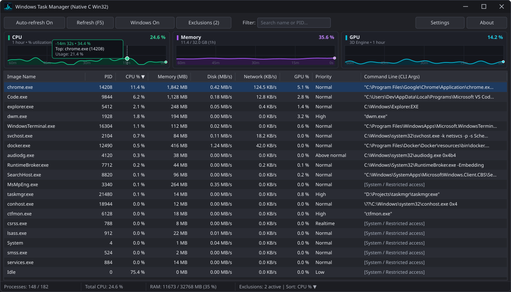
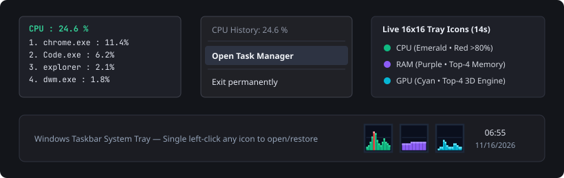
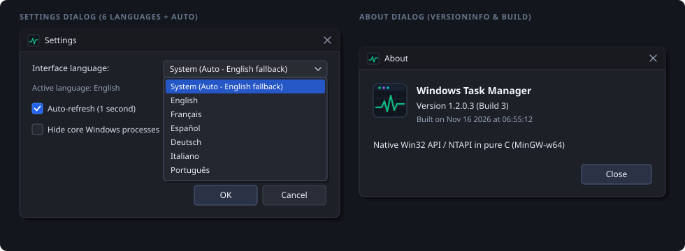

# Windows Task Manager (Pure C / Win32 API)

A lightweight, native **Windows Task Manager** written from scratch in **pure C** using only the Windows API (`Win32` & `NTAPI`) — zero external frameworks, zero runtime dependencies, and a tiny single executable (`taskmgr.exe`) compiled with **MinGW-w64**.



---

## Key Features

### Performance Monitoring & Live Graphs
- **1-Hour Rolling History (3,600s)** — Three real-time graphs at the top of the window tracking **CPU**, **Memory (RAM)**, and **GPU (3D Engine)** across the last hour (`60m` to `0s`).
- **Interactive Hover Inspector** — Moving the mouse over any point along a 1-hour graph displays a vertical tracker line and tooltip showing the timestamp (`-XXm YYs`), resource percentage, and the **top consuming process** at that exact second (image name, PID, and usage).
- **Per-Process Telemetry** — Tracks real-time **CPU %** (`GetProcessTimes` / `GetSystemTimes`), **Memory** (`WorkingSetSize`), **Disk I/O MB/s** (`ReadTransferCount + WriteTransferCount`), **Network I/O KB/s** (`OtherTransferCount`), **GPU %** (real WDDM engine utilization via PDH `\GPU Engine(*)\Utilization Percentage`), **Priority Class**, and full **Command Line (CLI Args)** read directly from the remote PEB (`NtQueryInformationProcess` + `ReadProcessMemory`).
- **Anti-Flicker Differential ListView** — Updates cells in place without clearing the list (`LVS_EX_DOUBLEBUFFER`), preserving scroll position and row selection during 1-second refreshes.
- **Interactive Sorting** — Click any column header to sort ascending/descending (`▲` / `▼` + native `HDF_SORTUP` / `HDF_SORTDOWN` indicators) while keeping column titles permanently visible.

### System Tray & Explorer Crash Recovery


- **3 Independent Dynamic Tray Icons** — Generates live 16×16 32-bit ARGB bar sparklines in memory (`CreateIconIndirect`) showing the last **14 seconds** of activity:
  - **CPU** (Emerald green, turns red above 80%)
  - **RAM** (Vibrant purple, turns red above 85%, tooltip lists Top-4 memory consumers)
  - **GPU** (Electric cyan, turns red above 80%)
- **Minimize to Tray on Close** — Clicking the window close button (`×`) hides the window to the system tray without interrupting monitoring.
- **Single-Click Restore** — A single left-click (or double-click) on any of the 3 tray icons immediately brings the window back to the foreground. Right-click opens a tray menu with **Open Task Manager** and **Exit permanently**.
- **Explorer Crash Recovery** — Listens for `TaskbarCreated` (with UIPI bypass via `ChangeWindowMessageFilterEx`) and falls back from `NIM_MODIFY` to `NIM_ADD` so all 3 tray icons are automatically restored if `explorer.exe` restarts or crashes.

### Multi-Language UI, Settings & About


- **6 Languages + Automatic System Detection** — Switch language on the fly (no restart required) via **Settings**:
  - `System (Auto)` — Detects the Windows UI language via `GetUserDefaultUILanguage()` and falls back to **English** if unsupported.
  - `English`, `Français`, `Español`, `Deutsch`, `Italiano`, `Português`.
- **Centralized Win32 Resource Strings** — Every label, column header, menu item, tooltip, status bar segment, and dialog string is stored in `src/resource.rc` (`STRINGTABLE` with UTF-8 codepage `65001`) and loaded via `LoadStringW`, with an in-memory fallback if compiled without `windres`.
- **About & Build Versioning (`src/version.h`)** — Displays the application version (`APP_VER_MAJOR.MINOR.PATCH.BUILD`), build number (`1.2.0.4 (Build 4)`), compile date/time, and native `VERSIONINFO` metadata in the PE binary.
- **Adaptive Windows Dark / Light Theme** — Follows the Windows system theme using `DwmSetWindowAttribute` and `uxtheme.dll`.

### Process Management & Filtering
- **Instant Termination (`Del`)** — Pressing `Delete` (or selecting *Kill immediately* in the context menu) terminates the selected process via `TerminateProcess` without confirmation prompts.
- **Live Filter & Windows Process Toggle** — Filter processes in real time by name or PID, and hide/show core Windows OS processes (`%SystemRoot%`, Microsoft-signed/system processes) with one click.
- **Persistent Process Exclusions** — Right-click any process to hide it by name (`Hide "<name>" by name`), and manage or restore excluded processes from the `Exclusions (N)` toolbar button.
- **Single Instance & Elevated Privileges** — Enforces a single instance via a named Mutex (restoring the running window if launched again) and enables `SeDebugPrivilege` for full system visibility.

---

## Configuration (`settings.ini`)

Settings and exclusions are automatically saved to `settings.ini` alongside `taskmgr.exe`:

```ini
[Settings]
AutoRefresh=1
HideWindowsProcesses=0
Language=auto
SortColumn=2
SortAscending=0

[Exclusions]
Count=2
Process0=discord.exe
Process1=spotify.exe
```

Supported `Language` values: `auto`, `en`, `fr`, `es`, `de`, `it`, `pt`.

---

## Project Structure

```text
.
├── Makefile                # Root build configuration (MinGW-w64)
├── README.md
├── screenshots/            # Documentation screenshots
│   ├── main-window.png
│   ├── settings-about.png
│   └── tray-icons.png
└── src/
    ├── app.ico             # Multi-resolution 16/32/48px 32-bit ARGB icon
    ├── resource.h          # Resource & string table IDs
    ├── resource.rc         # Multilingual STRINGTABLE (FR/EN/ES/DE/IT/PT) & VERSIONINFO
    ├── taskmgr.c           # Core Win32 / NTAPI application
    ├── taskmgr.manifest    # Common Controls v6 & DPI awareness manifest
    └── version.h           # Version & incremental build number macros
```

---

## Building with MinGW-w64

### Option 1: Using `make` (Recommended)

```cmd
mingw32-make
```

Compiles `src/resource.rc` with `windres` (embedding the icon, manifest, `VERSIONINFO`, and multilingual string tables) and builds `taskmgr.exe`.

### Option 2: Manual 2-Step Build

```cmd
windres --codepage=65001 -I src src/resource.rc -O coff -o src/resource.o
gcc -mwindows -O2 -s -Wall -Wextra -finput-charset=UTF-8 -fexec-charset=UTF-8 -Isrc -o taskmgr.exe src/taskmgr.c src/resource.o -lcomctl32 -lpsapi -lntdll -lole32 -lshell32 -lgdi32 -luxtheme -ldwmapi
```

### Option 3: Single-Line Standalone Build

```cmd
gcc -mwindows -O2 -s -Wall -Wextra -finput-charset=UTF-8 -fexec-charset=UTF-8 -Isrc -o taskmgr.exe src/taskmgr.c -lcomctl32 -lpsapi -lntdll -lole32 -lshell32 -lgdi32 -luxtheme -ldwmapi
```

*(Even without `windres`, `taskmgr.c` includes a programmatic GDI fallback `CreateTaskManagerAppIcon` and built-in UTF-16 string fallbacks.)*

---

## Keyboard Shortcuts & Controls

| Input | Action |
| :--- | :--- |
| **`Del`** | Kill selected process immediately (no confirmation) |
| **`F5`** | Force immediate refresh of process list & metrics |
| **Column Header Click** | Sort processes ascending / descending |
| **Right-Click on Row** | Kill immediately, Set priority, Copy CLI args, Open file location, Hide by name |
| **Graph Hover** | Inspect historical value and top process at that timestamp |
| **Window Close (`×`)** | Minimize application to the Windows System Tray |
| **Tray Left-Click** | Open / restore the main window to the foreground |
| **Tray Right-Click** | Open context menu (*Open Task Manager* / *Exit permanently*) |
